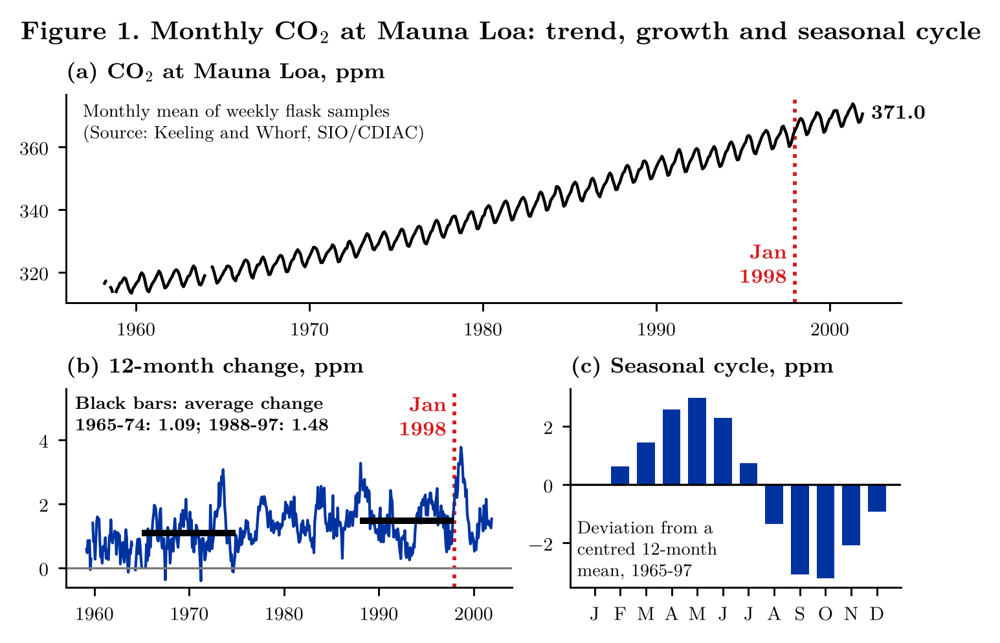
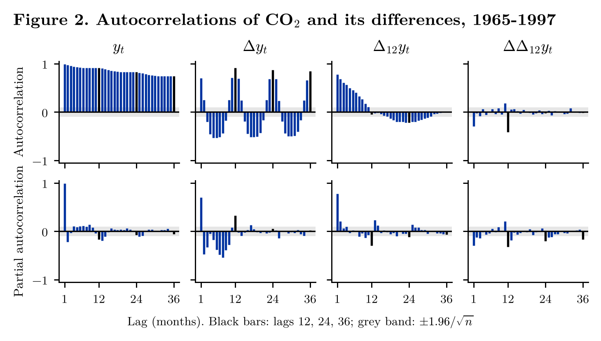
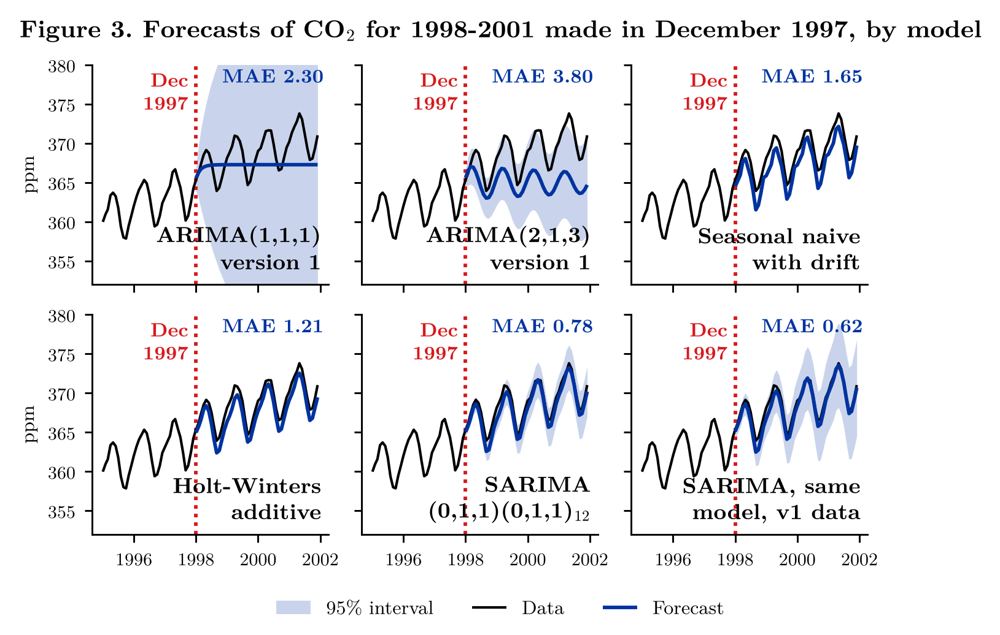
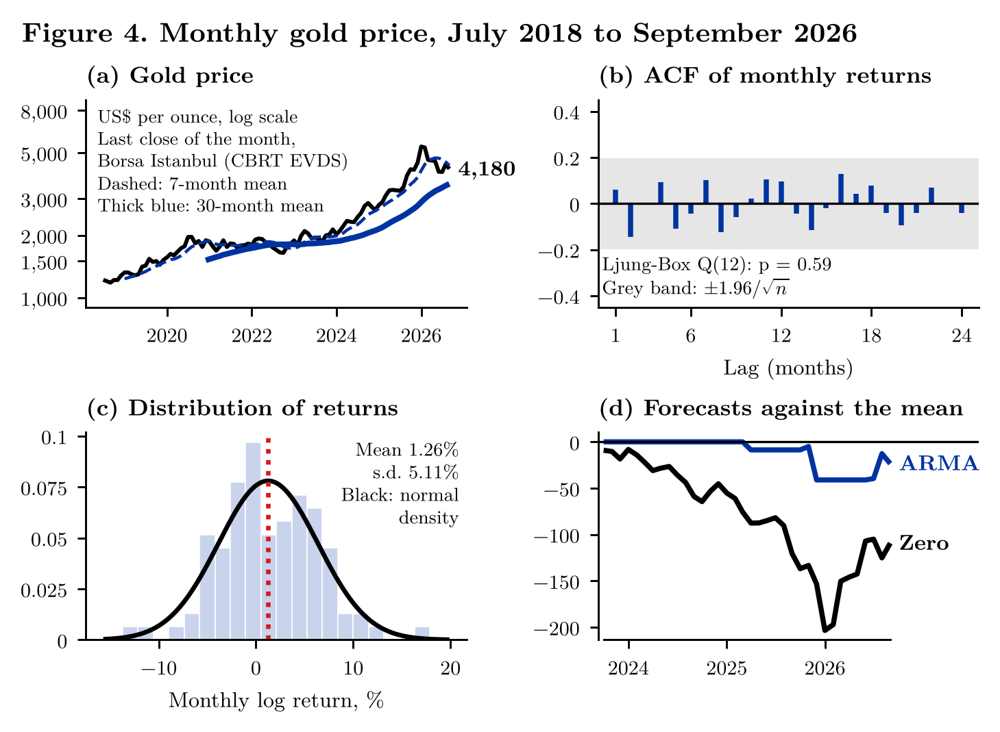

# ARMA_CO2_gold: Box–Jenkins in Practice

[](https://github.com/mikbalyilmaz/ARMA_CO2_gold/actions/workflows/tests.yml)
[](LICENSE)

Version 2 of an application of the topics of an undergraduate time-series course to two monthly series:

1. **CO₂ at Mauna Loa:** which model forecasts the 48 months of 1998–2001 from December 1997, and how is it found?
   Unit-root tests, correlograms, seasonal ARIMA selected by AIC, Ljung–Box checks, benchmarks.
2. **Gold price:** is there anything in the past of monthly gold returns that an ARMA model can use?

The project note, [`paper/arma_note.pdf`](paper/arma_note.pdf), explains each step and writes out the mathematics.

## CO₂: from the data to the model

Weekly flask samples at Mauna Loa (as shipped with `statsmodels`), averaged to months as in version 1. Five months
have no sample; version 1 filled them with the next month, version 2 starts in January 1965 and fills nothing.

**Figure 1.** (a) The level, 1958–2001. (b) The change over twelve months. (c) The seasonal cycle: 6.2 ppm from the
May peak to the October trough.



**Figure 2.** Autocorrelations of the level and its differences. After one difference the autocorrelations return
at lags 12, 24 and 36; after both differences only lags 1 and 12 remain, the pattern of the airline model
$(0,1,1)(0,1,1)_{12}$, which AIC also selects among 36 candidates with $d = D = 1$ fixed.



## CO₂: forecasts for 1998–2001

| Model | MAE (ppm) | RMSE (ppm) |
|---|---|---|
| ARIMA(1,1,1), version 1 | 2.30 | 2.80 |
| ARIMA(2,1,3), version 1 (chosen by AIC across $d$) | 3.80 | 4.24 |
| Seasonal naive with drift | 1.65 | 1.70 |
| Holt–Winters, additive | 1.21 | 1.25 |
| **SARIMA(0,1,1)(0,1,1)₁₂** | **0.78** | **0.87** |

The two models of version 1 have no seasonal part and, with $d = 1$ in `statsmodels`, no drift, so their forecasts
level off. Version 1 chose ARIMA(2,1,3) by comparing AIC across differencing orders, which compares likelihoods of
different data.

**Figure 3.** Forecasts made in December 1997, one panel per model, with 95% intervals where the model gives one.



## Gold: is there an ARMA in the returns?

Gold closing price on Borsa Istanbul, US dollars per troy ounce, last close of each month, July 2018 to September
2026 (CBRT EVDS, series TP.ALTINPIYASA.KAP03). Monthly log returns average 1.26% with a standard deviation of 5.11%
and show no autocorrelation (Ljung–Box $Q(12)$, $p = 0.59$). One-month-ahead forecasts for the last 36 months, with
the ARMA order chosen again by AIC every month, do not beat the historical mean (out-of-sample $R^2 = -0.017$; the
random walk: $-0.077$).

**Figure 4.** (a) The price with version 1's moving averages, now labelled 7 and 30 *months*. (b) Autocorrelations
of returns. (c) Their distribution. (d) Cumulative squared error of the historical mean minus that of each model;
a rising line would mean the model beats the mean.



All numbers are in `figures/*.csv` and in the project note.

## Contents

| Path | What it is |
|---|---|
| `armaco2/data.py` | Monthly CO₂ (version 1 and version 2 samples), the train/test split of version 1, the gold series |
| `armaco2/models.py` | Unit-root tests, seasonal ARIMA estimation and AIC selection with fixed differences, benchmarks, accuracy, Ljung–Box |
| `armaco2/legacy.py` | Runs the CO₂ notebook of version 1 unchanged, for comparison |
| `data/` | Frozen CO₂ series (`freeze_co2.py`), the EVDS gold export and `prepare_gold.py` |
| `tests/run_tests.py` | Unit tests against direct formulas, simulations with a known answer, the EVDS file and the printed output of version 1 |
| `analysis/01_co2_identification.py` | Unit roots, correlograms, version 1's AIC search, seasonal ARIMA selection (Figures 1, 2) |
| `analysis/02_co2_forecast.py` | Forecasts for 1998–2001 and their accuracy (Figure 3) |
| `analysis/03_gold.py` | Gold: smoothers, unit roots, ARMA selection, recursive forecasts (Figure 4) |
| `analysis/run_all.py` | Runs the three analyses in order (a few minutes) |
| `figures/` | Figures as PNG (300 dpi) and PDF, every reported table as CSV |
| `paper/` | Project note; `make_paper.py` writes all its numbers from `figures/*.csv` |
| `legacy/` | Version 1 (both notebooks and the README), unchanged |
| `fonts/` | Latin Modern Roman (GUST Font License) |

## How to run

```
pip install -r requirements.txt
python tests/run_tests.py
cd analysis
python run_all.py
cd ../paper
python make_paper.py
xelatex arma_note.tex && xelatex arma_note.tex       # needs XeLaTeX
```

## Changes from version 1

See [NEWS.md](NEWS.md): what was added and a table of the corrections to version 1.

## Citation

See [CITATION.cff](CITATION.cff), or:

> Yılmaz, M. İ. (2026). *ARMA_CO2_gold: Box–Jenkins analysis of CO₂ at Mauna Loa and of the gold price*
> (Version 2.0.0) [Computer software]. https://github.com/mikbalyilmaz/ARMA_CO2_gold

## License

MIT, see [LICENSE](LICENSE).
